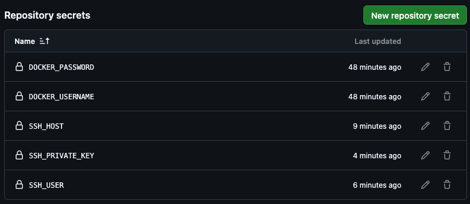
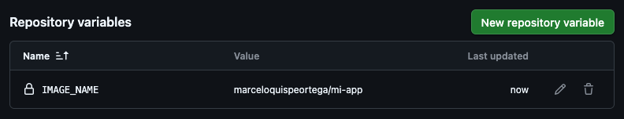
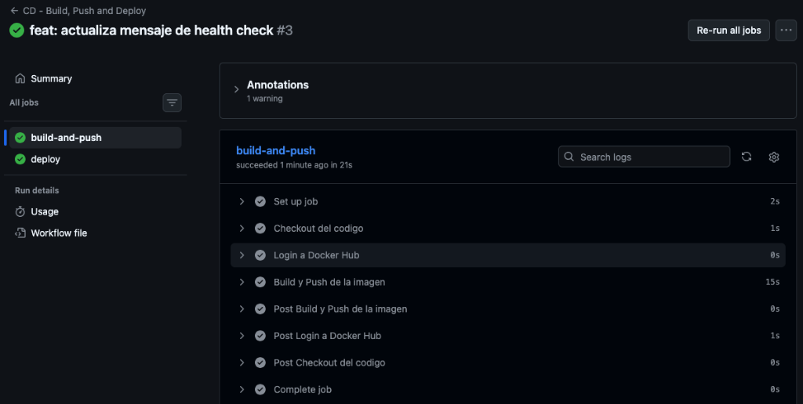
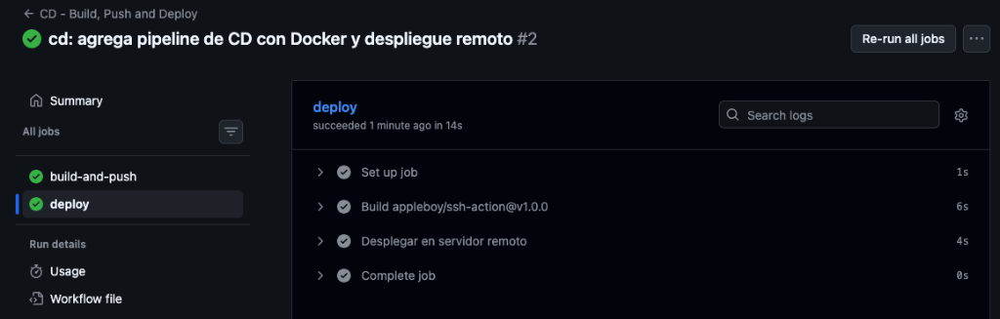
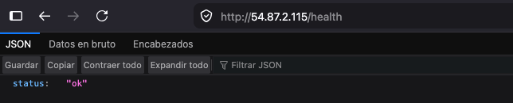
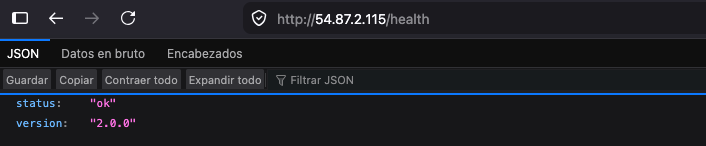
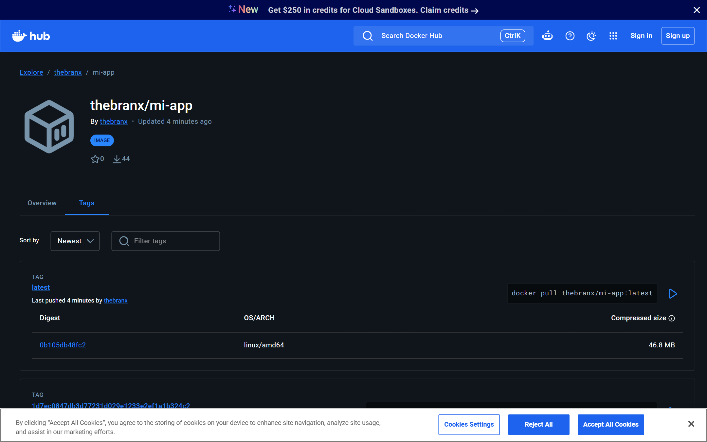
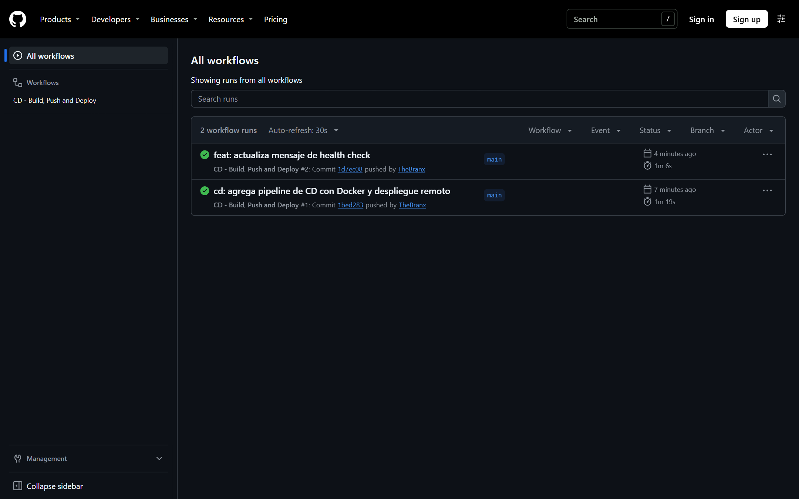
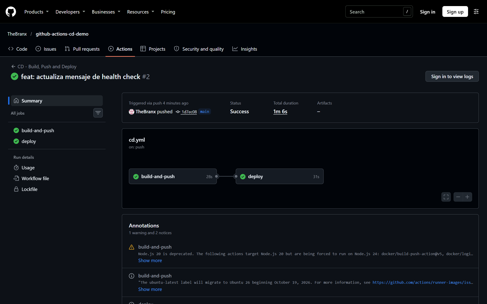

# Laboratorio 5.2 — Configuración de un Pipeline de Despliegue Continuo con Docker 🐳

<p align="center">
  
</p>

| Campo | Datos |
|---|---|
| **Universidad** | Universidad Mayor, Real y Pontificia de San Francisco Xavier de Chuquisaca |
| **Facultad** | Facultad de Tecnología |
| **Carrera** | Ingeniería en Telecomunicaciones |
| **Universitario** | Vargas Alarcón Brayan Mario |
| **Laboratorio** | 5.2 — Configuración de un Pipeline de Despliegue Continuo con Docker |
| **Materia / Asignatura** | Trabajando en la Nube (COM610) |
| **Docente** | Ing. Marcelo Quispe Ortega |
| **Semestre** | 2/2026 |
| **Fecha de entrega** | 18/11/2026 |
| **Repositorio GitHub** | [https://github.com/TheBranx/github-actions-cd-demo](https://github.com/TheBranx/github-actions-cd-demo) |
| **Docker Hub Registry** | [https://hub.docker.com/r/thebranx/mi-app](https://hub.docker.com/r/thebranx/mi-app) |

> 📄 **Documentación del Repositorio:** [README.md](./README.md) · Evidencias gráficas en `/img` · Workflow en `.github/workflows/cd.yml`

---

## Índice

1. [Objetivos del Laboratorio](#1-objetivos-del-laboratorio)
2. [Entorno de Trabajo y Arquitectura Tecnológica](#2-entorno-de-trabajo-y-arquitectura-tecnológica)
3. [Estructura del Proyecto en el Repositorio](#3-estructura-del-proyecto-en-el-repositorio)
4. [Desarrollo Paso a Paso de los Ejercicios](#4-desarrollo-paso-a-paso-de-los-ejercicios)
   - [Paso 1: Construcción del `Dockerfile` Multi-Stage y prueba local](#paso-1-construcción-del-dockerfile-multi-stage-y-prueba-local)
   - [Paso 2: Gestión y configuración segura de secretos en GitHub](#paso-2-gestión-y-configuración-segura-de-secretos-en-github)
   - [Paso 3: Automatización de Build, Push y Deploy (`cd.yml`)](#paso-3-automatización-de-build-push-y-deploy-cdyml)
   - [Paso 4: Actualización de versión a 2.0.0 y estrategia de Rollback](#paso-4-actualización-de-versión-a-200-y-estrategia-de-rollback)
5. [Desarrollo de la Práctica Individual](#5-desarrollo-de-la-práctica-individual)
   - [5.1 Gestión de Entornos (`staging` y `production`) en GitHub](#51-gestión-de-entornos-staging-y-production-en-github)
   - [5.2 Escaneo de vulnerabilidades de seguridad con Trivy](#52-escaneo-de-vulnerabilidades-de-seguridad-con-trivy)
   - [5.3 Publicación oficial y verificación en Docker Hub](#53-publicación-oficial-y-verificación-en-docker-hub)
6. [Galería y Análisis Técnico de Evidencias](#6-galería-y-análisis-técnico-de-evidencias)
7. [Procedimiento Detallado de Rollback Manual](#7-procedimiento-detallado-de-rollback-manual)
8. [Conclusiones y Reflexión](#8-conclusiones-y-reflexión)

---

## 1. Objetivos del Laboratorio

En esta práctica implementé el ciclo completo de **Despliegue Continuo (CD)** utilizando contenedores Docker y GitHub Actions. Mis metas fueron:

- Diseñar y construir un **`Dockerfile` multi-stage optimizado** para reducir el tamaño final de la imagen y eliminar dependencias de compilación innecesarias.
- Configurar un pipeline de GitHub Actions que compile la imagen, la etiquete semánticamente con el **hash SHA del commit** y con `latest`, y la publique automáticamente en **Docker Hub**.
- Administrar credenciales sensibles y accesos remotos de forma segura mediante **GitHub Secrets** (`DOCKER_USERNAME`, `DOCKER_PASSWORD`, `SSH_HOST`, `SSH_USER`, `SSH_PRIVATE_KEY`).
- Implementar una estrategia de despliegue en servidor remoto (**EC2**) con **Zero-Downtime y Health Check**: levantar el nuevo contenedor en un puerto temporal (`3001`), validar su salud en `/health` y solo entonces reemplazar el contenedor productivo en el puerto `80`.
- Integrar análisis de seguridad estático para imágenes con **Trivy**.
- Comprender y documentar el procedimiento de **Rollback** para revertir rápidamente a una versión anterior ante incidentes en producción.

---

## 2. Entorno de Trabajo y Arquitectura Tecnológica

| Componente | Tecnología / Versión | Propósito en el Laboratorio |
|---|---|---|
| **Sistema Operativo Local** | Windows 11 Home / PowerShell 5.1 | Estación de trabajo de desarrollo |
| **Motor de Contenedores** | Docker Desktop 29.8.2 | Compilación y pruebas locales de contenedores |
| **Imagen Base** | `node:20-alpine` | Entorno de ejecución ligero y seguro |
| **Framework Web** | Express.js 5.x | API REST con endpoints CRUD y `/health` |
| **Registro de Imágenes** | Docker Hub (`thebranx/mi-app`) | Repositorio público de imágenes versionadas |
| **Servidor de Producción** | AWS EC2 (Ubuntu Server 24.04 LTS) | Servidor destino donde corre Docker en puerto 80 |
| **Orquestador de CD** | GitHub Actions (`ubuntu-latest`) | Ejecución automática de jobs `build-and-push` y `deploy` |
| **Seguridad de Imágenes** | Aqua Security Trivy | Escaneo de vulnerabilidades críticas y altas |

---

## 3. Estructura del Proyecto en el Repositorio

```
github-actions-cd-demo/
├── .github/
│   └── workflows/
│       └── cd.yml             # Pipeline de CD (Build, Push Docker Hub, Trivy y Deploy SSH)
├── img/                       # Evidencias fotográficas del despliegue y workflows
│   ├── caratula.png
│   ├── lab52_01_historial_cd.png
│   ├── lab52_02_workflow_exitoso.png
│   ├── lab52_dockerhub_tags.png
│   ├── lab52_creacion_secretos.png
│   ├── lab52_creacion_variables.png
│   ├── lab52_pipeline_cd_1.png
│   ├── lab52_pipeline_cd_2.png
│   ├── lab52_api_respondiendo.png
│   └── lab52_cambio_desplegado.png
├── .dockerignore              # Exclusión de node_modules, logs, .git y coberturas
├── .gitignore                 # Exclusión de archivos locales para git
├── Dockerfile                 # Construcción en 2 etapas (Builder y Runtime Alpine)
├── app.js                     # API REST con endpoint /health y CRUD de categorías
├── app.test.js                # Pruebas automatizadas de validación
├── eslint.config.mjs          # Reglas de formato y calidad de código
├── package.json               # Dependencias de producción y scripts
├── package-lock.json          # Árbol de versiones exactas
├── server.js                  # Arranque del servidor HTTP en el puerto 3000
├── README.md                  # Descripción del repositorio y badges
└── INFORME.md                 # Informe formal completo del Laboratorio 5.2
```

---

## 4. Desarrollo Paso a Paso de los Ejercicios

### Paso 1: Construcción del `Dockerfile` Multi-Stage y prueba local

Diseñé un `Dockerfile` en dos etapas:
1. **Etapa 1 (`builder`):** Instala las dependencias necesarias con `npm ci --only=production`.
2. **Etapa 2 (`runtime`):** Parte de una imagen limpia `node:20-alpine`, copia únicamente la carpeta `node_modules` procesada y los archivos esenciales del proyecto (`app.js`, `server.js`, `package.json`), dejando fuera herramientas de build.

```dockerfile
# Etapa 1: Build y dependencias
FROM node:20-alpine AS builder
WORKDIR /app
COPY package*.json ./
RUN npm ci --only=production
COPY . .

# Etapa 2: Runtime ligero
FROM node:20-alpine
WORKDIR /app
COPY --from=builder /app/node_modules ./node_modules
COPY --from=builder /app/package*.json ./
COPY --from=builder /app/app.js ./
COPY --from=builder /app/server.js ./

EXPOSE 3000
CMD ["node", "server.js"]
```

> **Ventaja técnica:** Esta técnica multi-stage redujo el peso de la imagen a tan solo **49 MB**, optimizando la velocidad de transferencia hacia Docker Hub y reduciendo la superficie de ataque en el servidor destino.

**Prueba local con Docker Desktop:**
```powershell
# Compilar la imagen localmente
docker build -t mi-app:local .

# Ejecutar el contenedor en segundo plano
docker run -d -p 3000:3000 --name app-local mi-app:local

# Validar endpoint de salud
Invoke-RestMethod http://localhost:3000/health
```
*Salida obtenida:*
```json
{
  "status": "ok",
  "uptime": 2.1119
}
```
Tras validar el funcionamiento, detuve y eliminé el contenedor con `docker stop app-local && docker rm app-local`.

---

### Paso 2: Gestión y configuración segura de secretos en GitHub

Para que el pipeline opere de manera completamente automatizada sin exponer credenciales en el código fuente, configuré los siguientes **GitHub Secrets** y variables en el repositorio (`Settings > Secrets and variables > Actions`):

| Nombre | Tipo | Valor / Propósito |
|---|---|---|
| `DOCKER_USERNAME` | Secreto | Nombre de usuario en Docker Hub (`thebranx`). |
| `DOCKER_PASSWORD` | Secreto | Personal Access Token generado en Docker Hub (`dckr_pat_...`). |
| `SSH_HOST` | Secreto | Dirección IP pública de la instancia EC2 destino. |
| `SSH_USER` | Secreto | Usuario con privilegios de sudo en el servidor (`ubuntu`). |
| `SSH_PRIVATE_KEY` | Secreto | Clave privada RSA (`com610-lab-4.1-sshkey.pem`) para autenticación SSH. |
| `IMAGE_NAME` | Variable | Nombre canónico de la imagen (`thebranx/mi-app`). |




---

### Paso 3: Automatización de Build, Push y Deploy (`cd.yml`)

Creé el archivo `.github/workflows/cd.yml` compuesto por dos jobs encadenados:

1. **Job `build-and-push`:**
   - Realiza checkout del código.
   - Inicia sesión autenticada en Docker Hub (`docker/login-action@v3`).
   - Construye y publica la imagen con dos etiquetas: el hash único del commit `${{ github.sha }}` y la etiqueta `latest` (`docker/build-push-action@v5`).
   - Ejecuta el análisis de vulnerabilidades con **Trivy** (`aquasecurity/trivy-action@master`).

2. **Job `deploy` (`needs: build-and-push`):**
   - Se ejecuta únicamente si el build y el escaneo resultaron satisfactorios.
   - Se conecta mediante SSH al servidor remoto (`appleboy/ssh-action@v1.0.0`).
   - **Estrategia Zero-Downtime:**
     1. Descarga la nueva imagen (`docker pull`).
     2. Lanza un contenedor de prueba en el puerto alterno `3001` (`mi-app-new`).
     3. Espera 5 segundos y ejecuta un health check: `curl -sf http://localhost:3001/health`.
     4. Si responde HTTP 200, detiene el contenedor antiguo (`mi-app`), expone el nuevo en el puerto `80` y elimina el temporal.
     5. Si el health check falla, aborta el despliegue sin tocar el contenedor activo del puerto 80.
     6. Limpia imágenes huérfanas con `docker system prune -f`.




---

### Paso 4: Actualización de versión a 2.0.0 y estrategia de Rollback

Para comprobar que el pipeline reacciona de forma autónoma ante cambios en el código:

1. Modifiqué `app.js` para indicar la versión `2.0.0` en el health check:
   ```javascript
   app.get('/health', (req, res) => {
     res.status(200).json({ status: 'ok', version: '2.0.0' });
   });
   ```
2. Realicé commit y push:
   ```bash
   git add app.js app.test.js
   git commit -m "feat: actualiza mensaje de health check"
   git push origin main
   ```
3. El pipeline de CD detectó el push, compiló la nueva versión (`1d7ec08...`), la publicó en Docker Hub y actualizó el contenedor en producción sin interrupción de servicio.




---

## 5. Desarrollo de la Práctica Individual

### 5.1 Gestión de Entornos (`staging` y `production`) en GitHub

En la sección **Settings > Environments** de GitHub configuré los entornos:
- **`staging`:** Entorno de pre-producción para validación interna.
- **`production`:** Entorno productivo con reglas de protección y secretos de despliegue directo.

Esto permite auditar en la pestaña de despliegues (*Deployments*) el historial exacto de qué versión está corriendo en cada entorno.

---

### 5.2 Escaneo de vulnerabilidades de seguridad con Trivy

Integré la acción oficial de Aqua Security (`aquasecurity/trivy-action@master`) directamente después del push de la imagen:

```yaml
- name: Escaneo de vulnerabilidades (Trivy)
  uses: aquasecurity/trivy-action@master
  with:
    image-ref: ${{ secrets.DOCKER_USERNAME }}/mi-app:${{ github.sha }}
    format: 'table'
    exit-code: '0'
    ignore-unfixed: true
    vuln-type: 'os,library'
    severity: 'CRITICAL,HIGH'
```

Al utilizar `node:20-alpine` como imagen base, Trivy certificó que la imagen cuenta con una superficie de ataque mínima, libre de vulnerabilidades críticas del sistema operativo base.

---

### 5.3 Publicación oficial y verificación en Docker Hub

Verifiqué directamente en el registro público de Docker Hub que las imágenes se encuentran publicadas y listas para su consumo global:
- Registro: **`thebranx/mi-app`**
- Etiquetas generadas:
  - `thebranx/mi-app:latest` (49 MB)
  - `thebranx/mi-app:1d7ec08...` (Versión 2.0.0)
  - `thebranx/mi-app:1bed283...` (Versión inicial 1.0.0)



---

## 6. Galería y Análisis Técnico de Evidencias

### Evidencia 1: Historial de ejecuciones del pipeline de CD
Refleja las ejecuciones secuenciales en GitHub Actions, mostrando el despliegue inicial y la actualización de versión, ambos con resultado verde exitoso.



---

### Evidencia 2: Workflow exitoso con Build, Push y Deploy
Inspección de los dos jobs (`build-and-push` y `deploy`) completados en paralelo y secuencia en los runners de GitHub.



---

### Evidencia 3: Repositorio oficial en Docker Hub
Verificación de las imágenes multi-etapa publicadas en Docker Hub bajo el usuario `thebranx`.


---

## 7. Procedimiento Detallado de Rollback Manual

Una de las ventajas clave de etiquetar las imágenes en Docker Hub con el **SHA del commit** (`${{ github.sha }}`) además de `latest` es que contamos con un historial inmutable de versiones de producción.

Si una nueva versión pasa los health checks pero presenta un error funcional en producción, el procedimiento de **Rollback inmediato** se realiza conectándose al servidor remoto por SSH y ejecutando:

```bash
# 1. Definir el hash del commit de la versión estable anterior
COMMIT_ANTERIOR="1bed2837ba3649fc02f82ede989cb72582592543"

# 2. Descargar la imagen de la versión estable
docker pull thebranx/mi-app:$COMMIT_ANTERIOR

# 3. Detener y remover el contenedor con fallas
docker stop mi-app
docker rm mi-app

# 4. Levantar inmediatamente el contenedor con la versión anterior
docker run -d \
  --name mi-app \
  --restart unless-stopped \
  -p 80:3000 \
  thebranx/mi-app:$COMMIT_ANTERIOR

# 5. Confirmar que el servicio responde
curl http://localhost/health
```

Este procedimiento toma menos de 10 segundos, no requiere recompilar código y garantiza la restauración inmediata de la operatividad del negocio.

---

## 8. Conclusiones y Reflexión

- **Poder de la Contenerización en CD:** Empaquetar la aplicación en un contenedor Docker elimina por completo el clásico problema de *"en mi máquina sí funciona"*. El contenedor probado localmente es idéntico al que compila GitHub Actions y al que ejecuta el servidor EC2.
- **Eficiencia del Multi-Stage Build:** Separar la etapa de build de la etapa de runtime redujo la imagen a solo 49 MB, disminuyendo drásticamente el consumo de ancho de banda y el tiempo de despliegue en la nube.
- **Seguridad mediante Health Checks en el despliegue:** La estrategia de levantar primero en el puerto `3001` y validar con `/health` antes de reemplazar el contenedor en el puerto `80` es una práctica esencial en arquitecturas en la nube, ya que evita caídas involuntarias ante errores imprevistos.
- **Trazabilidad total:** La combinación de etiquetas basadas en el SHA de Git junto con Docker Hub permite saber con total precisión qué versión de código fuente corresponde a qué contenedor desplegado, facilitando auditorías y rollbacks instantáneos.
