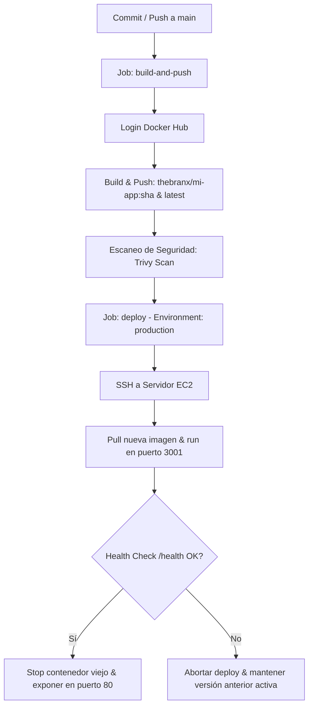

# GitHub Actions CD Demo - Pipeline de Despliegue Continuo con Docker 🐳

[](https://github.com/TheBranx/github-actions-cd-demo/actions/workflows/cd.yml)
[](https://hub.docker.com/r/thebranx/mi-app)
[](https://nodejs.org/)
[](LICENSE)

Repositorio desarrollado para el **Laboratorio 5.2: Configuración de un Pipeline de Despliegue Continuo con Docker** en la materia **Trabajando en la Nube (COM610)** de la **Universidad Mayor, Real y Pontificia de San Francisco Xavier de Chuquisaca (USFX)**.

Contiene una API RESTful contenerizada con **Docker (Multi-stage Build)**, un pipeline automatizado de **Despliegue Continuo (CD)** con **GitHub Actions**, escaneo de vulnerabilidades con **Trivy**, publicación de imágenes en **Docker Hub**, despliegue seguro en servidor remoto (**EC2**) con verificación de salud (*Zero-Downtime Health Check*), gestión de entornos (`staging` y `production`), y procedimientos de **Rollback** rápido.

---

## 📑 Documentación y Entrega del Laboratorio

Todo el procedimiento técnico, comandos ejecutados, justificaciones, análisis de incidencias y capturas de pantalla de evidencias se encuentran detallados en el informe formal del laboratorio:

👉 **[Ver Informe Completo del Laboratorio (INFORME.md)](./INFORME.md)**

---

## 🛠️ Stack Tecnológico

- **Lenguaje & Framework:** Node.js 20 (Alpine) + Express.js 5.x
- **Contenerización:** Docker con Build Multi-Etapa (*Multi-Stage Build*)
- **Registro de Contenedores:** Docker Hub (`thebranx/mi-app`)
- **Pipeline de CD:** GitHub Actions (`ubuntu-latest`)
- **Seguridad:** Escaneo estático de vulnerabilidades con `aquasecurity/trivy-action`
- **Despliegue Remoto:** SSH Action (`appleboy/ssh-action`) hacia instancia AWS EC2 (Ubuntu Server)
- **Estrategia de Despliegue:** Validación previa en puerto alterno (`3001`) con verificación `/health` antes de conmutar al puerto de producción (`80`)

---

## 🚀 Inicio Rápido Local con Docker

### 1. Construir la imagen optimizada (Multi-Stage)
```bash
docker build -t mi-app:local .
```

### 2. Ejecutar el contenedor
```bash
docker run -d -p 3000:3000 --name app-local mi-app:local
```

### 3. Verificar el endpoint de salud
```bash
curl http://localhost:3000/health
# o en PowerShell:
Invoke-RestMethod http://localhost:3000/health
```

### 4. Probar la imagen oficial desde Docker Hub
```bash
docker pull thebranx/mi-app:latest
docker run -d -p 3000:3000 --name app-hub thebranx/mi-app:latest
```

---

## 🔄 Arquitectura del Pipeline de Despliegue



---

## 👤 Autor

- **Universitario:** Vargas Alarcón Brayan Mario
- **Carrera:** Ingeniería en Telecomunicaciones
- **Materia:** Trabajando en la Nube (COM610)
- **Docente:** Ing. Marcelo Quispe Ortega
- **Institución:** Universidad Mayor, Real y Pontificia de San Francisco Xavier de Chuquisaca (USFX)
